<p align="center">
  
</p>

<h1 align="center">Open Micer Timer</h1>

<p align="center">
  <b>A giant, hands-free stage timer for open mics, comedy sets and talks.</b><br>
  iPhone · iPad · Mac — built with SwiftUI
</p>

<p align="center">
  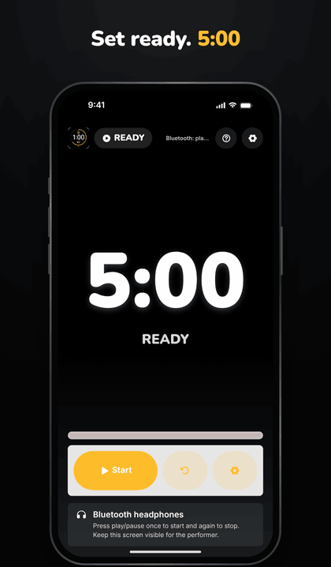
</p>

<p align="center">
  ▶️ <a href="docs/media/demo.mp4"><b>Watch the demo video (MP4)</b></a>
</p>

---

## Why

The host lights you, you lose track of time, you run long. Open Micer Timer puts a countdown on stage that the performer can read from the mic — and the host can start and stop it from across the room with a pair of Bluetooth headphones.

## Features

| | |
| --- | --- |
| 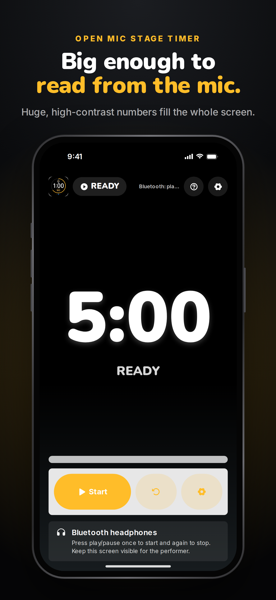 | **Big enough to read from the mic.** Huge, high-contrast numbers fill the whole screen. |
| 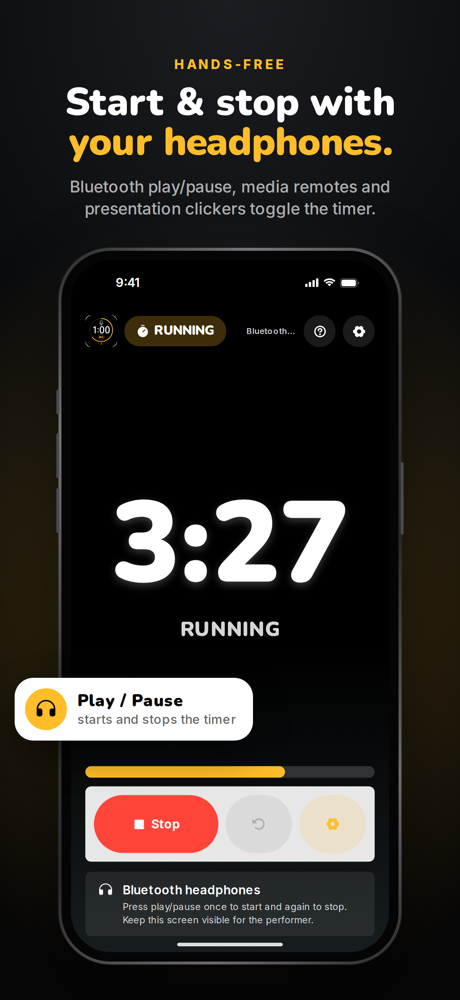 | **Start & stop with your headphones.** Bluetooth play/pause, media remotes and presentation clickers toggle the timer. On Mac: Space, Return or play/pause. |
| 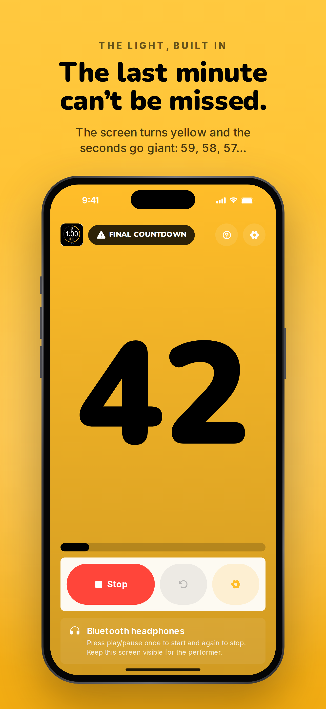 | **The last minute can't be missed.** The screen turns yellow and the seconds go giant: 59, 58, 57… |
| 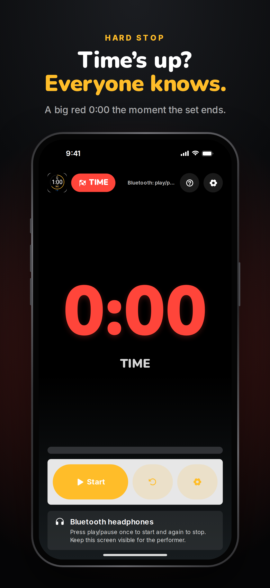 | **Time's up? Everyone knows.** Red 0:00 — no arguing with the light. |
| 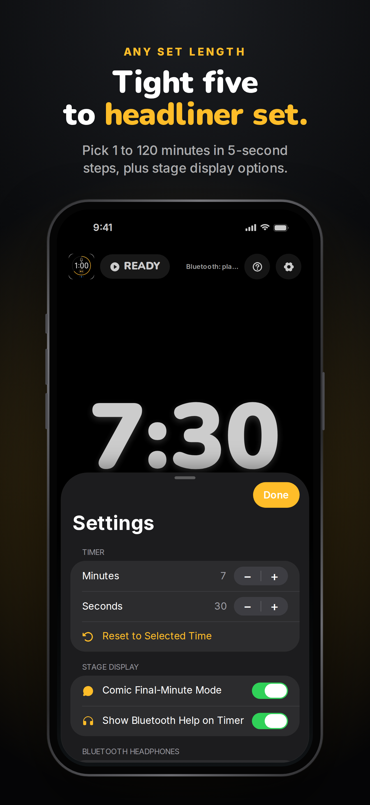 | **Tight five to headliner set.** Any length from 1 minute to 2 hours, in 5-second steps. |
| 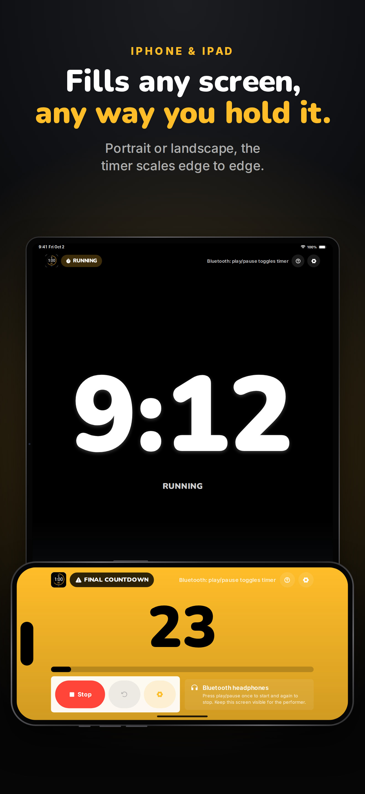 | **Fills any screen, any way you hold it.** Portrait or landscape, phone or tablet. |

### On iPad

<p align="center">
  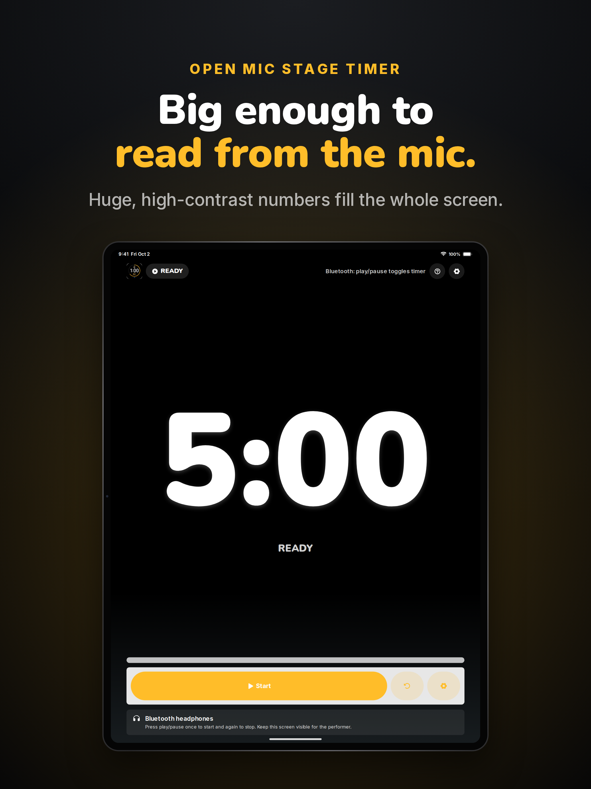
  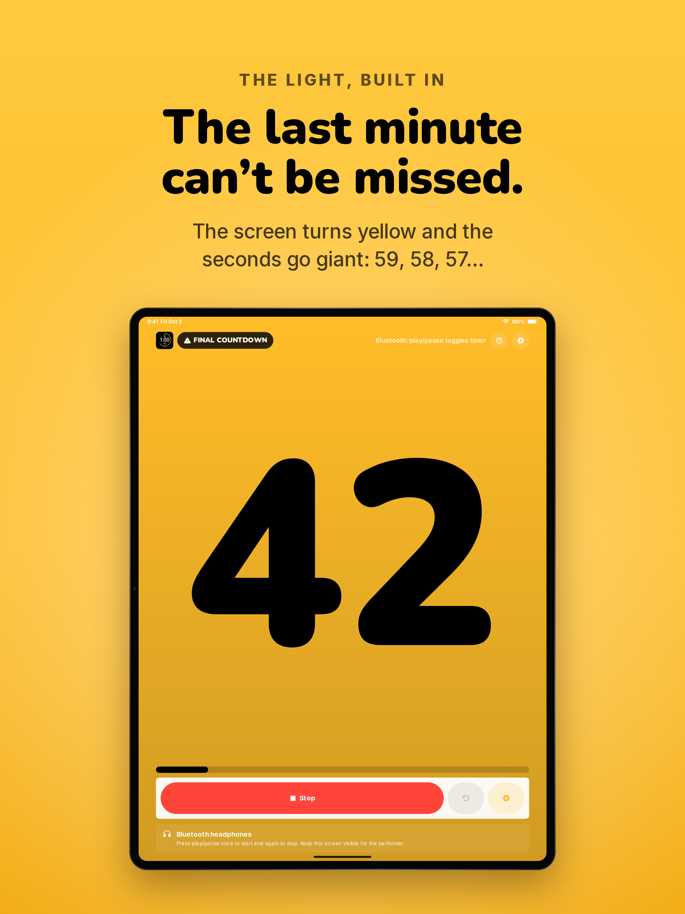
  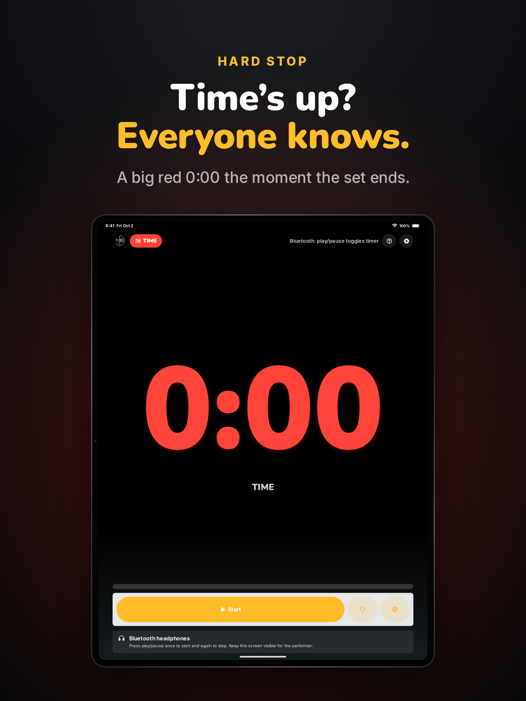
</p>

### On Mac

<p align="center">
  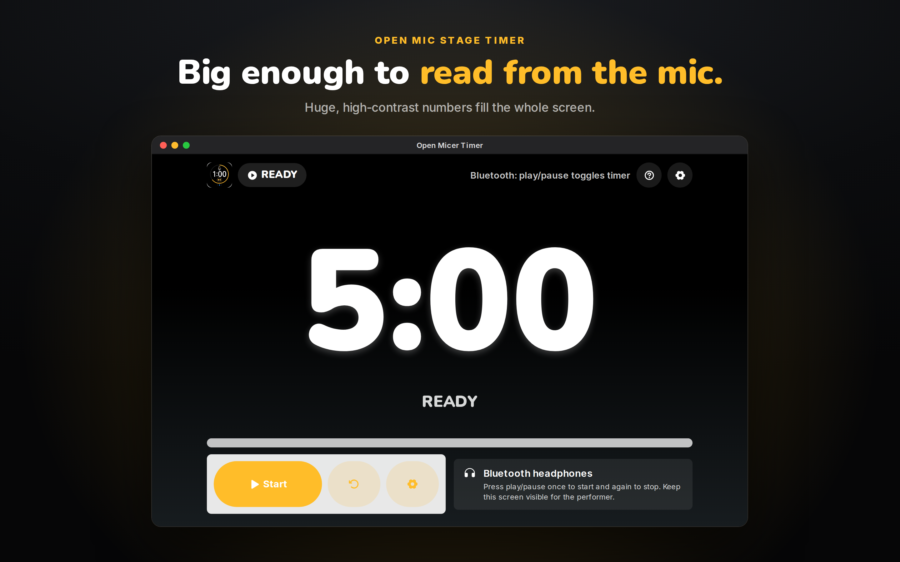
  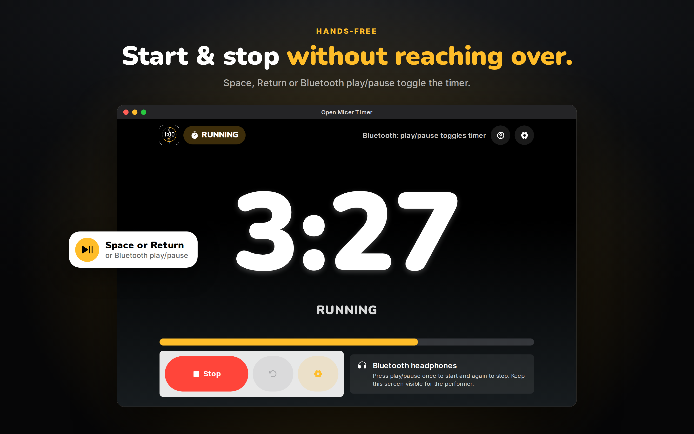
</p>
<p align="center">
  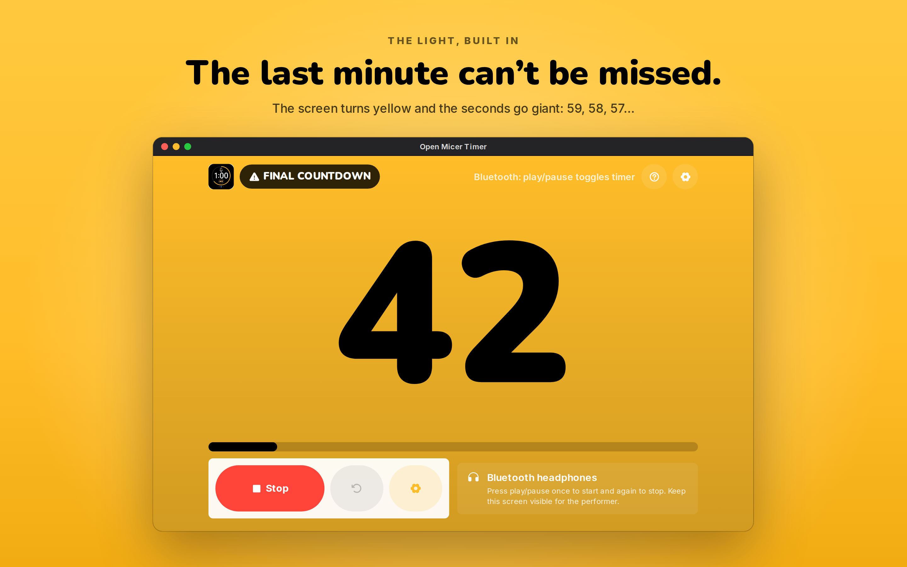
  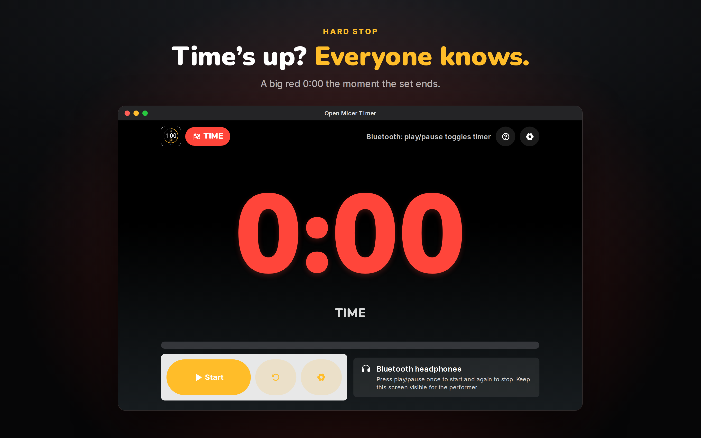
</p>

## How to use

1. Set the length with the ⚙️ button (default **5:00**).
2. Put the device where the performer can see it.
3. Press **Start** — or press play/pause on connected Bluetooth headphones, a media remote or a clicker.
4. At **1:00** the screen turns yellow, then counts the final seconds in giant numbers.
5. At **0:00** it turns red. Press **Reset** for the next act.

**Settings:** set length, turn final-minute mode on/off, show/hide the headphone hint, replay the tutorial.

> **Selfie-stick remotes:** models that send media or keyboard commands work. Models that only trigger the camera shutter or volume button are blocked by iOS for normal apps.

## Build & run

Requirements: Xcode 26+, deployment target iOS / iPadOS / macOS 26.1.

```sh
git clone https://github.com/taylordrew4u2/Open-Micer-Timer.git
open "Open-Micer-Timer/Open Micer Timer.xcodeproj"
```

Pick an iPhone, iPad or My Mac destination and press **⌘R**.

## Project layout

```
Open Micer Timer/            SwiftUI app (ContentView.swift holds the stage timer, settings and tutorial)
Open Micer Timer.xcodeproj/  Xcode project
AppStoreScreenshots/         App Store screenshot sets + the generator that renders them
docs/media/                  README demo video and GIF
```

## Regenerating screenshots & demo video

The screenshots and the demo are rendered from an HTML replica of the timer screen with headless Chromium (Playwright). The demo also needs `ffmpeg`.

```sh
cd AppStoreScreenshots/generator
npm install
npm run render   # App Store screenshot sets + preview.png
npm run demo     # docs/media/demo.mp4 + demo.gif
```

See [`AppStoreScreenshots/README.md`](AppStoreScreenshots/README.md) for details.

<p align="center">
  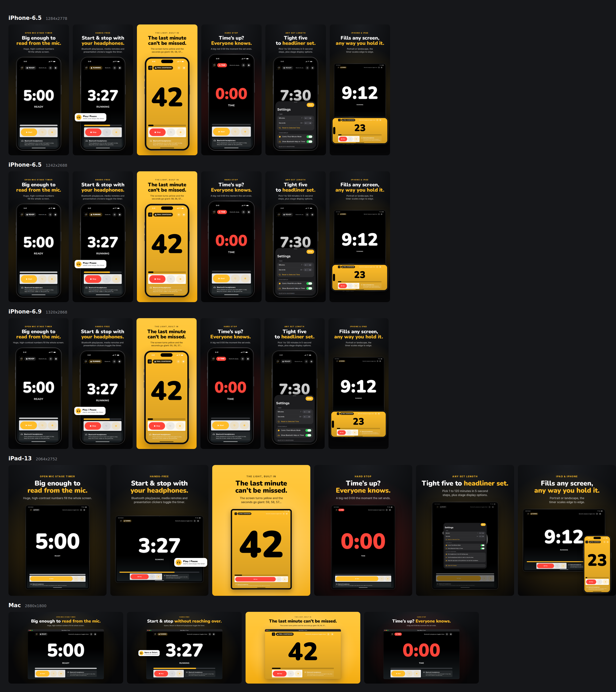
</p>
